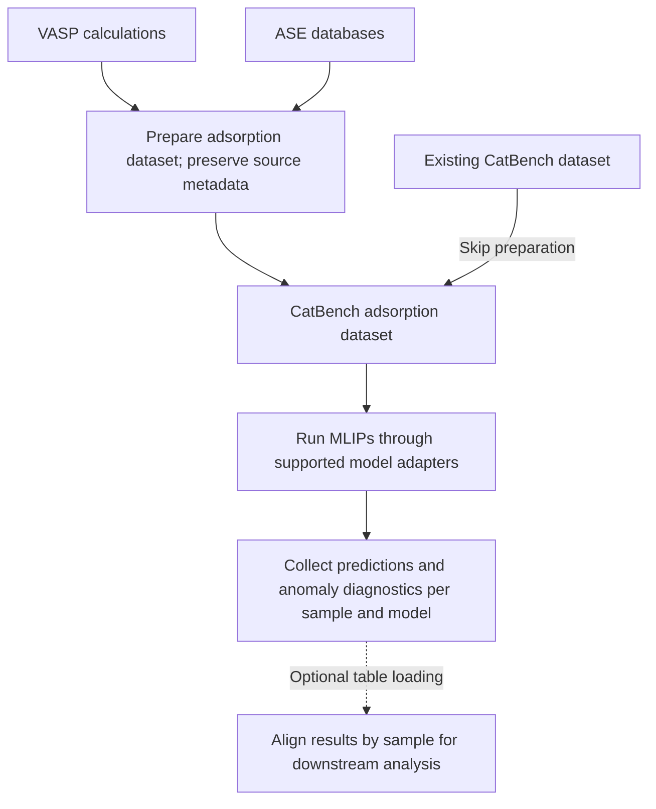

# Moira

Moira runs machine-learned interatomic potentials (MLIPs) on adsorption datasets
and keeps each sample's predictions linked to its source metadata and anomaly
flags. MLIPs predict atomic energies and forces; comparing their predictions
helps assess how strongly an atom or molecule binds to a catalyst surface.

The project grew out of a need to run ten MLIPs with different implementations
and software environments through a common workflow. Extracted from Oasis,
Moira handles dataset preparation, model execution, and result extraction so
that predictions remain traceable across models and calculations.

That traceability supports prediction abstention: a downstream study can exclude
an anomalous prediction from one model while retaining other models' predictions
for the same sample. [Oasis](https://github.com/SiliconScientist/oasis) evaluates
anomaly-aware filtering in its ensemble studies. Moira supplies the predictions
and diagnostics needed to test such policies on further datasets.



Existing datasets retain the metadata they supply. Result files preserve
sample–model associations; optional table loading aligns compatible results
across models. See [alignment limits](docs/results-and-diagnostics.md#aligned-results).

## Capabilities

- Prepare CatBench adsorption datasets from mapped VASP calculations or ASE
  databases, preserving source metadata and supported structural constraints.
- Run models through Rootstock or dedicated adapters with separate model
  environments. The ten registered adapters cover Allegro, AlphaNet, AQCat25,
  CHGNet, GRACE, MACE, MatterSim, ORB v3, SevenNet, and UMA.
- Retain adsorption energies, sample metadata, and CatBench-derived anomaly
  classifications and details in each model's result files.
- Submit Slurm arrays, split large datasets into isolated shards, collect their
  results, and reuse relaxed clean slabs shared by multiple adsorption samples.
- Load results into a table with model-specific energy, label, and diagnostic
  columns aligned by reaction identifier.

**Scope:** Moira produces predictions and diagnostics for downstream analysis.
Anomaly flags depend on the configured calculations and detection thresholds;
an unflagged prediction is not a guarantee of accuracy. Filtering policies and
comparisons of their benefits belong to the downstream study.

<a id="sample-tracking-and-catbench-changes"></a>

## Sample traceability

Moira keeps each sample's source metadata, model predictions, and anomaly
diagnostics together. These associations let researchers trace a result back to
its input and examine why a prediction was flagged, supporting reproducible
comparisons and explicit abstention decisions for individual model predictions.

Anomaly detection identifies warning signs; it does not establish prediction
accuracy. In particular, disagreement with reference energy requires a known
reference and cannot support abstention on unlabeled samples. See
[sample tracking and diagnostics](docs/results-and-diagnostics.md) for the
CatBench constraint patch, stored results, diagnostic rules, and limitations.

## Quickstart

You need Python 3.11 or newer, an input dataset, supported model environments,
model checkpoints or pretrained selectors, and Slurm access with suitable compute
resources. Moira does not bundle a self-contained local inference example; see
[local execution requirements](docs/workflows.md#local-execution-and-verification-limits).

**Install** from the repository root in an active Python environment
([installation details](docs/workflows.md#environment)):

```bash
python -m pip install -e ".[dev]"
```

**Configure** a run from the example:

```bash
cp config.example.toml config.toml
```

Before submitting, follow [run configuration](docs/workflows.md#configuration),
[model environments and checkpoints](docs/workflows.md#model-environments-and-checkpoints),
[dataset preparation](docs/workflows.md#ingest), and
[Slurm setup](docs/workflows.md#slurm-setup-and-execution) to replace placeholder
paths and prepare your inputs and compute environment.

**Execute** after setup:

```bash
moira --config config.toml --run-tag screen
```

This checks model environments and submits a Slurm array. See
[execution and outputs](docs/workflows.md#slurm-setup-and-execution) for job logs
and prediction results.

## Documentation

<!-- Preserve anchors from the original README. -->
<a id="naming"></a>
<a id="environment"></a>
<a id="aqcat25-setup"></a>
<a id="chgnet-setup"></a>
<a id="allegro-setup"></a>
<a id="entrypoints"></a>
<a id="ingest"></a>
<a id="sharded-runs"></a>
<a id="slab-cache"></a>
<a id="scope"></a>
<a id="testing"></a>

- [Setup and workflows](docs/workflows.md): model installation, CLI usage,
  sharding, slab caching, and test commands.
- [Sample tracking and diagnostics](docs/results-and-diagnostics.md): CatBench
  integration, anomaly thresholds, and result alignment limits.
- [Configuration example](config.example.toml) and [model environments](envs/README.md).
- [Ingestion contracts](src/moira/ingest/README.md): geometry, metadata, and result handoff.
- [Result loading](src/moira/mlip/artifacts.py) and
  [persisted analysis](src/moira/mlip/result_metadata.py).

## Related projects

| Project | Role |
| --- | --- |
| [**Intergen**](https://github.com/SiliconScientist/intergen) | Generates candidate atomic structures and adsorption sites. |
| **Moira** | Runs MLIP predictions and preserves sample-level anomaly diagnostics. |
| [**Oasis**](https://github.com/SiliconScientist/oasis) | Evaluates and adapts predictions using limited reference data, including anomaly-aware filtering. |

These projects have complementary roles but do not form an automatically
integrated pipeline; connecting their workflows requires separate setup.
